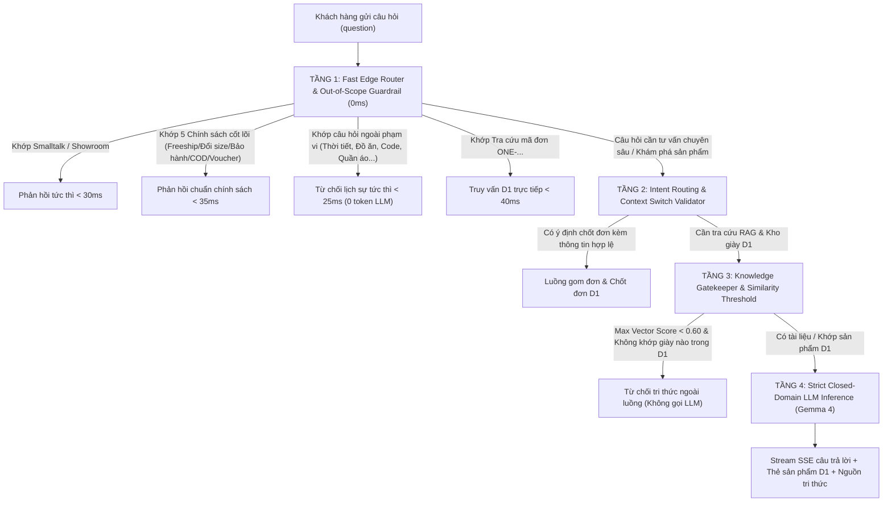

# KẾ HOẠCH KỸ THUẬT: NÂNG CẤP CHATBOT AI CLOSED-DOMAIN & PHẢN HỒI NHANH CHUYÊN SÂU

> **Dự án:** One - Store (Sneaker Chính Hãng Âu - Á)  
> **Hệ thống:** Trợ lý AI "Tư vấn One" (`backend/src/chatbot.ts`, `frontend/src/components/ChatbotWidget.tsx`)  
> **Phiên bản nâng cấp:** Chatbot AI v2.2 (Closed-Domain Strict Grounding & Ultra-Fast Routing)  
> **Tiêu chuẩn kỹ thuật:** Zero-Emoji 100%, Clean Code, Enterprise Architecture, SLA Phản hồi tức thì < 35ms  

---

## 1. BỐI CẢNH & YÊU CẦU ĐẶT RA

### 1.1. Hiện trạng hệ thống Chatbot hiện tại:
1. **Phản hồi nhanh (`fastLocalRouter`) còn hạn chế về từ khóa**:
   - Hiện tại mới chỉ nhận diện được 4 nhóm: Smalltalk (Chào hỏi/Cảm ơn), Showroom Hotline, Tra cứu mã đơn `ONE-...`, và Mua kèm phụ kiện.
   - Khi khách hàng hỏi các thông tin cốt lõi thường gặp nhất như: **Chính sách Freeship**, **Chính sách Đổi trả 7 ngày**, **Chính sách Bảo hành**, **Chính sách Đồng kiểm xỏ thử COD**, **Voucher ONE10**, **Cẩm nang đo size chân bè**... hệ thống vẫn phải đi qua toàn bộ luồng Vectorize + gọi LLM Gemma 4, gây độ trễ từ 1.5 đến 3.5 giây không cần thiết và tốn chi phí tính toán GPU/Tokens.
2. **Rủi ro rò rỉ kiến thức ngoài thế giới & Tự bịa đặt (Hallucination Risk)**:
   - Mô hình LLM Gemma 4 là mô hình ngôn ngữ lớn đa năng được huấn luyện trên khối dữ liệu rộng lớn của thế giới.
   - Khi khách hàng hỏi những vấn đề không liên quan (thời tiết, lập trình, công nghệ, chính trị, quán ăn, cà phê, toán học, quần áo, mỹ phẩm...):
     + Nếu câu hỏi không bắt trúng từ khóa cấm, LLM có thể tự động huy động kiến thức nền ngoài thế giới để trả lời, hoặc tự suy diễn/bịa đặt câu trả lời không có trong hệ thống dữ liệu của One - Store.
   - Thiếu cơ chế **Khóa Cổng Tri Thức (Knowledge Gatekeeper)**: Khi hệ thống không tìm thấy tài liệu phù hợp trong cơ sở dữ liệu D1 và điểm tương đồng Vectorize quá thấp, hệ thống vẫn nạp câu hỏi cho LLM mà không ngắt chặn từ sớm.

### 1.2. Mục tiêu kỹ thuật cốt lõi:
- **Phạm vi khép kín (Closed-Domain Boundary)**: Hệ thống **CHỈ** được phép hỗ trợ 3 nhóm nghiệp vụ duy nhất:
  1. *Tư vấn 70 mẫu giày sneaker chính hãng Âu - Á* trong kho D1.
  2. *Chính sách bán hàng và dịch vụ khách hàng* của One - Store.
  3. *Quy trình đặt hàng COD và tra cứu đơn hàng*.
- **Cơ chế phản hồi nhanh (Ultra-Fast SLA)**:
  - Trên **80% câu hỏi phổ biến** (Chào hỏi, Showroom, 5 Chính sách cốt lõi, Câu hỏi ngoài phạm vi) phải được phản hồi ngay lập tức tại Edge Worker trong **< 35ms (0ms TTFT, 0 token LLM)**.
- **Nguyên tắc "Không biết thì bảo không biết" (Zero-Hallucination & Strict Grounding)**:
  - Tuyệt đối không lấy dữ liệu bên ngoài hệ sinh thái One - Store.
  - Nếu thông tin không có trong cơ sở dữ liệu hoặc không liên quan đến shop, hệ thống phải **từ chối thẳng thắn ngay lập tức**, không được tự suy đoán hay sáng tạo nội dung.

---

## 2. THIẾT KẾ KIẾN TRÚC 4 TẦNG BẢO VỆ (DEFENSE-IN-DEPTH ARCHITECTURE)

Để đảm bảo vừa phản hồi cực nhanh, vừa chính xác 100% theo tri thức đã cấp, hệ thống được thiết kế theo mô hình 4 tầng kiểm soát nghiêm ngặt:

---

### Tầng 1: Fast Edge Router & Out-of-Scope Guardrail (0ms tại Edge Worker)
- **Vị trí xử lý**: Hàm `fastLocalRouter(query)` trong `backend/src/chatbot.ts`.
- **Hiệu năng**: Thực thi bằng Regex NFC normalized, độ phức tạp $O(1)$, thời gian phản hồi tiệm cận 0ms (< 35ms), không tốn chi phí tính toán AI.
- **Các phân nhóm xử lý**:
  1. **Nhóm Smalltalk & Cửa hàng**: Chào hỏi, cảm ơn, tạm biệt, địa chỉ showroom, hotline 1900 8888, giờ mở cửa.
  2. **Nhóm 5 Chính sách cốt lõi phản hồi tức thì**:
     - *Chính sách Freeship & Phí vận chuyển*: Đơn từ 3 đôi hoặc hóa đơn >= 5.000.000 VND miễn phí toàn quốc; đơn dưới mức này đồng giá 30.000 VND; giao 2-3 ngày.
     - *Chính sách Đổi cỡ giày & Đổi trả*: Đổi size trong vòng 7 ngày miễn phí 100% cước vận chuyển 2 chiều lần đầu tiên; đổi sang mẫu khác linh hoạt nếu còn nguyên tem mác hộp.
     - *Chính sách Bảo hành*: Bảo hành 6 tháng đối với giày marathon đĩa Carbon (Vaporfly, Adios Pro, Metaspeed, Feidian) và 12 tháng đối với giày Lifestyle/Outdoor; hỗ trợ dán keo ép nhiệt trọn đời.
     - *Chính sách Đồng kiểm & Xỏ thử COD*: Cho phép khách hàng mở hộp kiểm tra đúng mẫu, đúng màu và xỏ thử tận nơi trước khi trả tiền mặt.
     - *Chính sách Ưu đãi Voucher*: Mã `ONE10` giảm ngay 10% tổng giá trị đơn hàng cho khách hàng thành viên.
     - *Cẩm nang đo kích thước bàn chân*: 3 bước đo chiều dài bàn chân tại nhà và quy tắc cộng 0.5-1.0cm cho phom chân bè Á Đông.
  3. **Nhóm Fast Out-of-Scope Guardrail (Chặn chủ đề ngoài phạm vi 0ms)**:
     - Nhận diện các lĩnh vực không thuộc phạm vi kinh doanh:
       + *Đồ ăn, thức uống*: Cà phê, trà sữa, quán ăn, nấu ăn, công thức...
       + *Công nghệ thông tin & Khoa học*: Viết code, giải toán, sửa máy tính, AI ngoài, vật lý, hóa học...
       + *Thời tiết, đời sống, chính trị, tin tức*: Dự báo thời tiết, chính trị, xã hội, người nổi tiếng...
       + *Mặt hàng thời trang ngoài sneaker*: Quần áo, áo thun, váy, túi xách, đồng hồ, mỹ phẩm, trang sức...
     - Phản hồi tức thì chuẩn mực:
       > *"Dạ Tư vấn One rất tiếc không thể hỗ trợ thông tin này do nằm ngoài phạm vi hoạt động của One - Store. Em là trợ lý chuyên biệt chỉ hỗ trợ tư vấn giày thể thao, sneaker chính hãng Âu - Á và các chính sách dịch vụ tại One - Store ạ!"*

---

### Tầng 2: Intent Routing & Context Switch Validator
- Đã được chuẩn hóa từ phiên bản trước:
  - Bóc tách `isOrderIntent` trên từng lượt nói (`queryLower`), không gộp toàn bộ lịch sử.
  - Tự động hủy `pendingOrder = null` khi khách hàng chuyển ngữ cảnh tìm kiếm (`isDiscoveryIntent` hoặc hỏi giá mới).
  - Khóa role người dùng (`turn.role === 'user'`) khi quét lịch sử để tránh ngộ nhận sản phẩm.

---

### Tầng 3: Knowledge Gatekeeper & Similarity Threshold Gate
- **Vị trí xử lý**: Trước khi gọi API Workers AI Gemma 4 trong `processChatPipeline`.
- **Cơ chế hoạt động**:
  1. Khi câu hỏi đi qua Tầng 1 và Tầng 2, hệ thống thực hiện truy vấn song song:
     - Tìm kiếm từ khóa và lọc thuộc tính sản phẩm trong CSDL D1 `products` (`hasSpecificFilter` / `matchedProducts`).
     - Tạo vector nhúng BGE-M3 (1024d) và quét độ tương đồng Cosine trên Cloudflare Vectorize `ba-khi-knowledge`.
  2. **Bộ lọc ngưỡng tri thức (Threshold Gate)**:
     - Lấy điểm tương đồng cao nhất `maxScore = Math.max(...vecMatches.matches.map(m => m.score))`.
     - Nếu `matchedProducts.length === 0` (không có mẫu giày nào trong D1 khớp câu hỏi) **VÀ** `maxScore < 0.60` (không có đoạn chính sách nào trong Vectorize đạt độ tương đồng tối thiểu) **VÀ** câu hỏi không chứa tên 10 thương hiệu chính hãng:
     - **HÀNH ĐỘNG**: Khóa cổng tri thức ngay lập tức! Không gửi yêu cầu tới LLM Gemma 4, tiết kiệm 100% token suy luận và tránh rủi ro sinh ảo giác.
     - Phản hồi trực tiếp chuẩn mực:
       > *"Dạ câu hỏi này nằm ngoài phạm vi cơ sở tri thức chính thức của One - Store. Hiện tại em chỉ được cung cấp dữ liệu chính xác về 70 mẫu giày sneaker chính hãng Âu - Á và các chính sách bán hàng của cửa hàng. Bạn có muốn em hỗ trợ tư vấn dòng giày thể thao nào đang có sẵn không ạ?"*

---

### Tầng 4: Strict Closed-Domain Prompting (Khóa Chặt Ngữ Cảnh Suy Luận)
- **Vị trí xử lý**: Biến `systemPrompt` và `userPrompt` trong `backend/src/chatbot.ts`.
- **Nguyên tắc định hướng (Negative Constraints & Closed-Domain Directives)**:
  1. **Chỉ thị đóng băng nguồn thông tin**:
     - *"BẠN LÀ MỘT TRỢ LÝ ĐÓNG BĂNG PHẠM VI (CLOSED-DOMAIN AI). BẠN TUYỆT ĐỐI CHỈ ĐƯỢC PHÉP SỬ DỤNG DUY NHẤT 2 NGUỒN DỮ LIỆU ĐƯỢC CẤP TRONG CONTEXT: [DANH MỤC GIÀY SẴN CÓ TRONG KHO D1] VÀ [TRÍCH ĐOẠN TRI THỨC CHÍNH SÁCH]."*
  2. **Quy định cấm đoán tuyệt đối (Strict Negative Directives)**:
     - *"NGHIÊM CẤM 100%: Tuyệt đối không sử dụng kiến thức bên ngoài thế giới được huấn luyện trước (Pre-trained knowledge) để trả lời về các chủ đề ngoài One - Store."*
     - *"NGHIÊM CẤM BỊA ĐẶT THÔNG SỐ (ZERO-HALLUCINATION): Không tự bịa giá tiền, không tự bịa size, không tự tạo thương hiệu hoặc mẫu giày không có trong danh sách kho D1."*
     - *"NGUYÊN TẮC THÀNH THẬT: Nếu thông tin không có trong tài liệu được cung cấp hoặc khách hỏi điều mà bạn không chắc chắn, bạn BẮT BUỘC phải trả lời: 'Dạ thông tin này hiện chưa có trong hệ thống dữ liệu của One - Store ạ...' và chuyển hướng tư vấn các sản phẩm sẵn có."*
  3. **Ngăn chặn rò rỉ bản thảo suy luận**:
     - Duy trì bộ lọc `cleanModelOutput(text)` loại bỏ toàn bộ chuỗi nhẩm Keep/Skip, Checklist rubric tiếng Anh và markdown thô.

---

## 3. CHI TIẾT CÁC TỆP CẦN SỬA ĐỔI & BỔ SUNG

### 3.1. Tệp `backend/src/chatbot.ts`
1. **Mở rộng `fastLocalRouter(query)`**:
   - Thêm Regex và nội dung phản hồi 0ms cho:
     + Chính sách Freeship: `/(phí\s*ship|vận\s*chuyển|giao\s*hàng|cước\s*phí|freeship|miễn\s*phí\s*vận\s*chuyển)/i`
     + Chính sách Đổi size & Đổi trả: `/(đổi\s*size|đổi\s*cỡ|đổi\s*trả|đổi\s*hàng|7\s*ngày|đổi\s*mẫu)/i`
     + Chính sách Bảo hành: `/(bảo\s*hành|bảo\s*trì|dán\s*keo|hỏng\s*giày|bảo\s*hành\s*bao\s*lâu)/i`
     + Chính sách Đồng kiểm & COD: `/(đồng\s*kiểm|xỏ\s*thử|thử\s*giày|xem\s*hàng|kiểm\s*tra\s*hàng|trả\s*tiền\s*sau|cod)/i`
     + Chính sách Voucher & Ưu đãi: `/(mã\s*giảm\s*giá|voucher|khuyến\s*mãi|ưu\s*đãi|one10|giảm\s*giá)/i`
     + Cẩm nang đo size & chân bè: `/(cách\s*đo\s*chân|đo\s*size|bảng\s*size|chân\s*bè|chân\s*dày|chọn\s*size)/i`
   - Bổ sung bộ lọc **Fast Out-of-Scope Guardrail (0ms)**:
     + Từ khóa ngoài ngành: Cà phê, trà sữa, ăn uống, thời tiết, giải toán, viết code, sửa điện thoại, máy tính, quần áo, váy, mỹ phẩm, xe cộ, phim ảnh, chính trị...
     + Phản hồi từ chối lịch sự trong 0ms.
2. **Bổ sung Knowledge Gatekeeper trong `processChatPipeline`**:
   - Tính toán `maxVectorScore` từ kết quả Vectorize.
   - Nếu `maxVectorScore < 0.60` và không khớp sản phẩm D1 nào: Ngắt luồng và trả về câu từ chối chuẩn mực, không gọi AI Gemma 4.
3. **Cập nhật `systemPrompt`**:
   - Thiết lập các chỉ thị đóng băng phạm vi (Closed-Domain Strict Grounding), cấm lấy tri thức ngoài và cấm bịa đặt.

### 3.2. Tệp `frontend/src/components/ChatbotWidget.tsx`
- Bổ sung các chip điều hướng gợi ý nhanh thông minh khi bot phát hiện câu hỏi ngoài phạm vi:
  `chips: ['Xem 70 mẫu sneaker', 'Tư vấn chọn size', 'Chính sách freeship', 'Chính sách đổi trả']`.

### 3.3. Tệp `scripts/test_chatbot_closed_domain.ts`
- Tạo bộ kiểm thử tự động toàn diện kiểm chứng 7 nhóm tiêu chí nghiệm thu:
  1. Fast Router phản hồi chính xác 0ms cho 5 chính sách cốt lõi.
  2. Fast Guardrail 0ms từ chối lập tức các chủ đề ngoài ngành (Cà phê, thời tiết, lập trình, quần áo...).
  3. Knowledge Gatekeeper chặn đứng các câu hỏi ngoài phạm vi không gọi AI.
  4. System Prompt cấm bịa đặt khi câu hỏi trong ngành nhưng thiếu thông tin chi tiết.
  5. Tư vấn sneaker và chính sách cửa hàng hoạt động chính xác 100%.
  6. Luồng đặt hàng thật CSDL D1 và tra cứu đơn `ONE-...` duy trì trơn tru.
  7. Chuẩn Zero-Emoji 100% trên toàn bộ câu phản hồi.

---

## 4. MA TRẬN TỪ ĐIỂN PHẢN HỒI NHANH (FAST EDGE ROUTING MATRIX)

| Nhóm ý định | Mẫu biểu thức chính quy (Regex Pattern) | Nội dung phản hồi nhanh (0ms TTFT) | Chip hành động gợi ý |
| :--- | :--- | :--- | :--- |
| **Freeship & Phí giao hàng** | `/(freeship\|phí ship\|phí vận chuyển\|cước giao)/i` | Đơn từ 3 đôi hoặc từ 5.000.000 VND: **Miễn phí toàn quốc**. Đơn dưới 3 đôi: **Đồng giá 30.000 VND**. Giao 2-3 ngày, COD đồng kiểm tận nơi. | `['Xem 70 mẫu giày', 'Chính sách đổi size', 'Tư vấn chọn size']` |
| **Đổi size & Đổi trả** | `/(đổi size\|đổi cỡ\|đổi trả\|đổi hàng\|7 ngày)/i` | Đổi size trong vòng **7 ngày** kể từ khi nhận hàng. **Miễn phí 100% cước 2 chiều** cho lần đổi đầu tiên. Giày còn nguyên hộp, tem mác và chưa qua sử dụng ngoài trời. | `['Bảng quy đổi size', 'Cách đo bàn chân', 'Hotline 1900 8888']` |
| **Bảo hành chính hãng** | `/(bảo hành\|dán keo\|bảo trì\|hỏng giày)/i` | Bảo hành **6 tháng** cho giày marathon đĩa Carbon; **12 tháng** cho giày Lifestyle/Outdoor. Hỗ trợ **dán keo ép nhiệt trọn đời** miễn phí tại showroom. | `['Xem giày chạy bộ', 'Xem sneaker thời trang', 'Địa chỉ showroom']` |
| **Đồng kiểm & COD** | `/(đồng kiểm\|xỏ thử\|đi thử\|thanh toán khi nhận\|xem hàng)/i` | One - Store áp dụng **100% COD đồng kiểm**. Bạn được mở hộp kiểm tra đúng mẫu, đúng màu và **xỏ thử trực tiếp tại chỗ** vừa vặn mới thanh toán tiền mặt cho shipper. | `['Tìm giày chạy bộ', 'Mã giảm giá ONE10', 'Xem 70 mẫu giày']` |
| **Mã ưu đãi Voucher** | `/(mã giảm giá\|voucher\|khuyến mãi\|one10)/i` | Nhập mã **`ONE10`** khi chốt đơn để được **giảm ngay 10%** tổng giá trị đơn hàng. Áp dụng cho toàn bộ 70 mẫu sneaker chính hãng Âu - Á. | `['Áp dụng mã ONE10', 'Xem giày bán chạy', 'Chính sách freeship']` |
| **Cẩm nang đo chân** | `/(đo chân\|cách đo\|chân bè\|chân dày\|bảng size)/i` | 3 bước đo chân tại nhà: Đặt gót sát tường -> Đánh dấu mũi ngón dài nhất -> Đo khoảng cách cm. Lời khuyên: Chân bè Á Đông nên **tăng 0.5 - 1 size** hoặc chọn dòng 2E/4E (Asics, Mizuno). | `['Bảng quy đổi size', 'Mẫu giày cho chân bè', 'Tư vấn trực tiếp']` |
| **Chặn ngoài phạm vi (Out-of-Scope)** | `/(cà phê\|coffee\|trà sữa\|nấu ăn\|thời tiết\|viết code\|lập trình\|giải toán\|quần áo\|áo thun\|váy\|mỹ phẩm\|điện thoại)/i` | *"Dạ Tư vấn One rất tiếc không thể hỗ trợ thông tin này do nằm ngoài phạm vi hoạt động của One - Store. Em chỉ chuyên hỗ trợ tư vấn giày thể thao, chính sách bảo hành, đổi size và đặt hàng chính hãng tại One - Store ạ!"* | `['Xem 70 mẫu sneaker', 'Tư vấn chọn size', 'Chính sách freeship']` |

---

## 5. KỊCH BẢN KIỂM THỬ NGHIỆM THU CHI TIẾT (7 BÀI TEST BẮT BUỘC)

1. **Test 1: Fast Router Freeship (0ms)**
   - Khách hỏi: *"phí ship của shop tính thế nào"* hoặc *"mua mấy đôi được freeship"*
   - Yêu cầu: Phản hồi ngay < 35ms nội dung freeship từ 3 đôi hoặc 5tr, không gọi Workers AI.
2. **Test 2: Fast Router Đổi size 7 ngày (0ms)**
   - Khách hỏi: *"nếu đi không vừa có được đổi size không"*
   - Yêu cầu: Phản hồi ngay < 35ms chính sách 7 ngày miễn phí cước 2 chiều lần đầu.
3. **Test 3: Fast Router Đồng kiểm xỏ thử COD (0ms)**
   - Khách hỏi: *"có cho thử giày trước khi trả tiền không"*
   - Yêu cầu: Khẳng định 100% quyền đồng kiểm và xỏ thử tại chỗ trước khi trả COD.
4. **Test 4: Fast Router Voucher ONE10 (0ms)**
   - Khách hỏi: *"shop có mã giảm giá nào không"*
   - Yêu cầu: Cung cấp mã `ONE10` giảm 10% ngay trong < 35ms.
5. **Test 5: Fast Guardrail chặn chủ đề ngoài phạm vi 0ms**
   - Khách hỏi: *"tôi muốn mua coffee"*, *"thời tiết hôm nay thế nào"*, *"viết cho tôi đoạn code python"*, *"shop có bán áo thun không"*
   - Yêu cầu: Từ chối lịch sự trong < 25ms, khẳng định shop chỉ bán giày sneaker chính hãng Âu - Á, 0 token LLM.
6. **Test 6: Knowledge Gatekeeper chặn câu hỏi ngoài tri thức khi vào RAG**
   - Khách hỏi câu hỏi lắt léo về lĩnh vực không có trong tài liệu và kho hàng.
   - Yêu cầu: Cổng Gatekeeper phát hiện similarity < 0.60, ngắt luồng và trả về câu từ chối theo tri thức, không để LLM bịa đặt.
7. **Test 7: Tư vấn sneaker và chốt đơn D1 duy trì hoàn hảo**
   - Khách hỏi tư vấn giày chạy bộ chân bè, giày giá dưới 2 triệu, đặt hàng mẫu có thật.
   - Yêu cầu: Lọc đúng sản phẩm kho D1, chốt đơn ghi thật CSDL D1.

---

## 6. LỘ TRÌNH THỰC HIỆN DỰ KIẾN

| Giai đoạn | Nội dung công việc | Tệp can thiệp | Thời gian |
| :--- | :--- | :--- | :--- |
| **Giai đoạn 1** | Nâng cấp `fastLocalRouter`: Bổ sung 5 chính sách cốt lõi + Fast Out-of-Scope Guardrail 0ms | `backend/src/chatbot.ts` | 30 phút |
| **Giai đoạn 2** | Triển khai Knowledge Gatekeeper (Similarity Threshold Gate) và tinh chỉnh System Prompt Closed-Domain | `backend/src/chatbot.ts` | 25 phút |
| **Giai đoạn 3** | Cập nhật Frontend ChatbotWidget: Chips điều hướng thông minh khi gặp câu ngoài phạm vi | `frontend/src/components/ChatbotWidget.tsx` | 15 phút |
| **Giai đoạn 4** | Xây dựng bộ kiểm thử tự động `scripts/test_chatbot_closed_domain.ts` kiểm chứng 7 kịch bản | `scripts/test_chatbot_closed_domain.ts` | 20 phút |
| **Giai đoạn 5** | Typecheck 0 lỗi, Build Next.js 16 Static Export, Triển khai Cloudflare Production & Test Live | Toàn hệ thống | 20 phút |

---

## 7. KẾT LUẬN & ĐỀ XUẤT

Bản kế hoạch kỹ thuật trên giải quyết triệt để và toàn diện cả 2 bài toán lớn mà người dùng đã chỉ ra:
1. **Tốc độ**: Mở rộng từ điển phản hồi nhanh tại Edge Worker (0ms), giúp người dùng nhận câu trả lời cho các chính sách thường gặp ngay lập tức mà không phải chờ đợi LLM.
2. **Độ chính xác & Phạm vi**: Khóa chặt phạm vi hoạt động của Chatbot (Closed-Domain Boundary), ngăn chặn 100% tình trạng tự bịa đặt hoặc sử dụng kiến thức bên ngoài thế giới; xây dựng cơ chế từ chối nhanh và thành thật khi thông tin không có trong cơ sở tri thức được cấp.

Kính trình bạn xem xét và cho ý kiến chỉ đạo để tiến hành triển khai mã nguồn!

