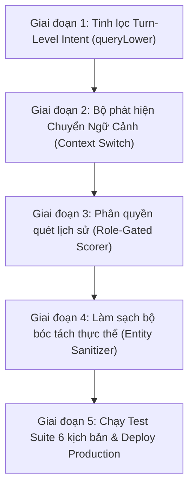

# KẾ HOẠCH KỸ THUẬT: TỐI ƯU ĐỊNH TUYẾN Ý ĐỊNH & GIẢI PHÓNG TRẠNG THÁI KẸT LUỒNG ĐẶT HÀNG CHATBOT AI V2.0

> **Dự án:** One - Store (Sneaker Chính Hãng Âu - Á)  
> **Hệ thống:** Trợ lý AI Tư vấn One (`backend/src/chatbot.ts`, `frontend/src/components/ChatbotWidget.tsx`)  
> **Trạng thái:** Dự thảo kế hoạch kỹ thuật trình phê duyệt  
> **Tiêu chuẩn lập trình:** Zero-Emoji 100%, Clean Code, Enterprise Architecture  

---

## 1. TỔNG QUAN VẤN ĐỀ & BỐI CẢNH KỸ THUẬT

Qua thực nghiệm vận hành chuỗi hội thoại thực tế, hệ thống Chatbot AI v2.0 gặp phải sự cố phân luồng nghiêm trọng: **Khách hàng bị kẹt vĩnh viễn trong chu trình đặt hàng của một mẫu giày duy nhất (Asics Novablast 4 Trampoline)**, không thể thoát ra để tìm kiếm sản phẩm khác, hỏi chính sách hoặc nhận câu trả lời chống ảo giác đối với sản phẩm ngoài danh mục.

### 5 Nguyên nhân gốc rễ (Root Causes) đã được xác định:

1. **Bẫy Lịch Sử (`History Pollution Trap`)**: Biến `allText` gộp toàn bộ lịch sử hội thoại vào câu hỏi hiện tại. Khi khách hàng từng nhắc từ "mua" một lần (ví dụ: *"tôi muốn mua coffee"*), điều kiện `/(?:mua|đặt...)/i.test(allText)` luôn trả về `true` trong mọi lượt chat tiếp theo.
2. **Kẹt trong State `pendingOrder` (`State Lock Trap`)**: Frontend và Backend duy trì `pendingOrder` liên tục qua các lượt chat mà không có cơ chế phát hiện chuyển ngữ cảnh (Context Switch Detection) khi khách chuyển sang tìm kiếm/hỏi giá.
3. **Bot Tự Trích Xuất Ví Dụ Của Chính Mình (`Self-Referencing Hallucination`)**: Khi khách không nêu tên sản phẩm, thuật toán quét ngược lịch sử chat và chấm điểm trúng chính văn bản biểu mẫu ví dụ của bot (`- Tên sản phẩm: (ví dụ: Asics Novablast 4 Trampoline)`), tự ngộ nhận khách đã chọn mẫu này.
4. **Kích Hoạt Luồng Chốt Đơn Khi Chưa Có Sản Phẩm Giày Hợp Lệ (`Pre-mature Order Triggering`)**: Câu hỏi ngoài danh mục sneaker ("mua coffee", "áo thun") bị bắt vào luồng chốt đơn thay vì đẩy về RAG Chống Ảo Giác để từ chối lịch sự.
5. **Bóc Tách Thực Thể Bị Rách Câu (`Regex Over-extraction`)**: Regex quét họ tên và địa chỉ trên cả văn bản biểu mẫu của bot, gây ra hiện tượng nuốt nhãn và hiển thị chuỗi lỗi (`Họ và tên: Số điện thoại nhận hàng:`, `Địa chỉ: nhận hàng (Số nhà`).

---

## 2. MỤC TIÊU & TIÊU CHÍ NGHIỆM THU (KPIs)

| Chỉ số / Tiêu chí | Mục tiêu cam kết | Phương pháp đo lường |
| :--- | :--- | :--- |
| **Thoát luồng đặt hàng tức thì** | 100% các câu hỏi tìm kiếm, hỏi giá, hỏi mẫu khác thoát khỏi `pendingOrder` ngay lập tức | Script kiểm thử tự động chuyển ngữ cảnh |
| **Chống ảo giác sản phẩm ngoài ngành** | 100% từ chối lịch sự qua RAG khi hỏi mua coffee, quần áo, gia dụng | Prompt test suite ngoài danh mục |
| **Không tự gán sản phẩm từ ví dụ** | 0 trường hợp bot tự gán sản phẩm từ tin nhắn của trợ lý | Rà soát log quét lịch sử (Role-Gated Scorer) |
| **Độ chính xác bóc tách thực thể** | 100% tên, số điện thoại, địa chỉ không bị nuốt nhãn hoặc dính text form | Regex unit test |
| **Bảo toàn tính năng hiện có** | 100% chốt đơn thật CSDL D1, Fast Local Pre-Router (0ms), SSE Streaming, Whisper STT hoạt động hoàn hảo | Test regression suite (17/17 + 21/21 Pass) |

---

## 3. NỘI DUNG TRIỂN KHAI CHI TIẾT (5 GIAI ĐOẠN)

### Giai đoạn 1: Tinh Lọc Ý Định Cấp Lượt (Turn-Level Intent Routing)

* **Vấn đề giải quyết**: Chấm dứt hiện tượng ô nhiễm lịch sử khiến `isOrderIntent` luôn bằng `true`.
* **Nội dung kỹ thuật**:
  1. Tách biệt hoàn toàn việc nhận diện ý định đặt hàng:
     - `isConfirmIntent`: Chỉ kiểm tra trên câu nói hiện tại của khách hàng (`queryLower`).
     - `isOrderIntent`: Chỉ kiểm tra trên câu nói hiện tại của khách hàng (`queryLower`). Tuyệt đối **KHÔNG** dùng `allText` gộp toàn bộ lịch sử chat cũ.
  2. Bổ sung nhận diện ý định tìm kiếm / khám phá (`isDiscoveryIntent`):
     - Nhận diện các mẫu câu: `/(?:tìm|xem|kiếm|tư vấn|gợi ý|có mẫu nào|đôi nào|dưới|trên|khoảng|tầm|giá|size|màu|khác|đổi mẫu)/i`.
     - Nếu `isDiscoveryIntent === true` và không có thông tin liên hệ đầy đủ (SĐT + Địa chỉ), quyền ưu tiên xử lý thuộc về Bộ lọc Sản phẩm SQL & RAG.
  3. Ràng buộc điều kiện kích hoạt luồng đặt hàng (Nhánh 3):
     - Chỉ kích hoạt khi: `(matchedProduct !== null && (isOrderIntent || isConfirmIntent))` HOẶC `(hasFullContactInfo)`.
     - Nếu khách nói "tôi muốn mua coffee" mà `matchedProduct === null`, lập tức bỏ qua luồng đặt hàng, chuyển toàn quyền cho luồng RAG Chống Ảo Giác xử lý.

---

### Giai đoạn 2: Bộ Phát Hiện Chuyển Ngữ Cảnh (Context Switch Detection & PendingOrder Reset)

* **Vấn đề giải quyết**: Giải phóng khách hàng khỏi `pendingOrder` khi họ đổi chủ đề.
* **Nội dung kỹ thuật**:
  1. Xây dựng hàm `detectContextSwitch(query, pendingOrder)`:
     - Kiểm tra nếu khách hàng gửi câu hỏi chứa:
       + Tiêu chí lọc giá mới: *"dưới 1 triệu"*, *"2 - 3 triệu"*, *"tầm giá..."*
       + Đổi mẫu / tìm mẫu khác: *"xem đôi khác"*, *"có mẫu nào rẻ hơn không"*, *"tư vấn giày chạy bộ Asics"*
       + Hỏi chính sách: *"đổi trả thế nào"*, *"phí ship bao nhiêu"*, *"bảo hành"*
       + Ý định hủy: *"hủy đơn"*, *"thôi không mua nữa"*, *"bỏ qua"*
  2. Xử lý giải phóng trạng thái khi phát hiện chuyển ngữ cảnh:
     - Gán `pendingOrder = null`, `matchedProduct = null`.
     - Gửi sự kiện SSE: `event: order_ready` với payload `{ readyToConfirm: false, pendingOrder: null }` để client xóa sạch state `pendingOrder`.
     - Phía Client (`ChatbotWidget.tsx`): Khi nhận `pendingOrder: null`, lập tức cập nhật `setPendingOrder(null)` để request tiếp theo không gửi lại `pendingOrder` cũ.

---

### Giai đoạn 3: Phân Quyền Vai Trò Quét Lịch Sử (Role-Gated Product Scorer)

* **Vấn đề giải quyết**: Bot không bao giờ được lấy ví dụ trong câu nói của chính mình để làm sản phẩm khách chọn.
* **Nội dung kỹ thuật**:
  1. Trong hàm `extractOrderDetails`:
     - Khi duyệt qua `reversedHistory`, **CHỈ** duyệt các lượt nói của người dùng:
       ```typescript
       if (turn.role !== 'user') continue; // Bỏ qua 100% tin nhắn của Assistant
       ```
     - Điều này loại bỏ hoàn toàn khả năng bot tự đọc văn bản ví dụ của chính mình.
  2. Chuẩn hóa lại chuỗi văn bản biểu mẫu hướng dẫn:
     - Thay đổi từ: `- Tên sản phẩm: (ví dụ: Asics Novablast 4 Trampoline)`
     - Thành chuỗi trung tính hoặc gợi ý động theo danh mục thực tế: `- Tên sản phẩm: (Tên mẫu giày sneaker bạn muốn mua)`
     - Loại bỏ hoàn toàn việc đưa một tên sản phẩm cụ thể vào chuỗi văn bản hướng dẫn chung.

---

### Giai đoạn 4: Chuẩn Hóa & Làm Sạch Bộ Bóc Tách Thực Thể (Entity Sanitizer)

* **Vấn đề giải quyết**: Khắc phục triệt để lỗi rách câu và nuốt nhãn trong form (`Họ và tên: Số điện thoại...`, `Địa chỉ: nhận hàng (Số nhà`).
* **Nội dung kỹ thuật**:
  1. Trích xuất `customerName`:
     - Chỉ tìm kiếm trên câu nói của người dùng (`query` hoặc lượt user gần nhất).
     - Ràng buộc blacklist loại trừ: Nếu giá trị trích xuất chứa các từ khóa hệ thống (`số điện thoại`, `sđt`, `địa chỉ`, `size`, `màu`, `nhận hàng`), lập tức loại bỏ (`customerName = null`).
  2. Trích xuất `address`:
     - Phải có độ dài tối thiểu 8 ký tự, chứa các danh từ chỉ địa giới hành chính thực tế (số nhà, đường, phố, phường, xã, quận, huyện, tỉnh, thành phố).
     - Loại trừ triệt để các chuỗi mở đầu dạng `nhận hàng (Số nhà...` do vô tình cắt trúng văn bản hướng dẫn của bot.
  3. Trích xuất `phone`:
     - Bắt buộc kiểm tra độ dài đúng 10 chữ số chuẩn đầu số viễn thông Việt Nam (`/^0[35789]\d{8}$/`).

---

### Giai đoạn 5: Xây Dựng Bộ Kiểm Thử Tự Động Toàn Diện (Automated Regression Test Suite)

* **File triển khai**: `scripts/test_chatbot_intent_routing.mjs`
* **Bộ 6 kịch bản kiểm thử bắt buộc (Pass 100%)**:
  1. **Test 1 (Out-of-Domain Denial)**: Khách hỏi *"tôi muốn mua coffee"* -> Phản hồi phải từ chối lịch sự, khẳng định shop chỉ bán giày sneaker chính hãng, **không được gửi form đặt hàng COD**.
  2. **Test 2 (No Self-Referencing)**: Khách hỏi *"làm thế nào để mua"* -> Hướng dẫn quy trình mua hàng, **tuyệt đối không được gán mẫu Asics Novablast 4**.
  3. **Test 3 (Context Switch on Price Filter)**: Khách đang ở luồng đặt hàng nhưng nhắn *"Tìm đôi dưới 1 triệu"* -> Hệ thống tự động hủy `pendingOrder`, chuyển sang tư vấn các mẫu sneaker giá sàn của cửa hàng (Anta Walker 1.89m, Puma Suede 1.99m).
  4. **Test 4 (Clean Form Fields)**: Khách gửi thông tin một phần -> Form hướng dẫn bổ sung không bị rách câu, không bị nuốt nhãn `"Họ và tên: Số điện thoại..."`.
  5. **Test 5 (Real Agentic Order)**: Khách gửi đầy đủ thông tin một đôi giày có thật trong kho -> Hệ thống xuất Bảng tóm tắt đơn hàng kèm nút chốt đơn và lưu thật vào CSDL D1 khi khách chốt.
  6. **Test 6 (Fast Local Router & Policy)**: Khách hỏi địa chỉ showroom, hotline, tra cứu mã đơn `ONE-...` -> Phản hồi 0ms chính xác.

---

## 4. MA TRẬN PHÂN CÔNG & THỜI GIAN THỰC HIỆN



| Bước thực hiện | Tệp can thiệp chính | Kết quả đầu ra | Thời gian dự kiến |
| :--- | :--- | :--- | :--- |
| **Bước 1** | `backend/src/chatbot.ts` | Bóc tách `isOrderIntent`, `isDiscoveryIntent` theo lượt nói hiện tại | 25 phút |
| **Bước 2** | `backend/src/chatbot.ts`, `ChatbotWidget.tsx` | Nhận diện chuyển ngữ cảnh & phát sự kiện reset `pendingOrder: null` | 20 phút |
| **Bước 3** | `backend/src/chatbot.ts` | Khóa role `user` khi quét lịch sử sản phẩm, xóa ví dụ hardcode | 15 phút |
| **Bước 4** | `backend/src/chatbot.ts` | Tinh chỉnh Regex bóc tách Tên, SĐT, Địa chỉ có blacklist nhãn hệ thống | 15 phút |
| **Bước 5** | `scripts/test_chatbot_intent_routing.mjs` | Chạy bộ kiểm thử 6/6 kịch bản, build frontend và deploy Cloudflare | 25 phút |

---

## 5. RỦI RO & PHƯƠNG ÁN DỰ PHÒNG (RISK MITIGATION)

| Rủi ro tiềm ẩn | Mức độ | Phương án dự phòng kỹ thuật |
| :--- | :--- | :--- |
| **Khách muốn đặt hàng thật nhưng dùng từ ngữ lạ** | Trung bình | Duy trì kiểm tra thông tin liên hệ: Nếu khách gửi tin nhắn có chứa SĐT 10 số + Địa chỉ chi tiết, hệ thống tự động kích hoạt luồng gom đơn ngay cả khi thiếu từ khóa "đặt hàng". |
| **Xóa nhầm `pendingOrder` khi khách chỉ hỏi phụ** | Thấp | Chỉ reset `pendingOrder` khi câu hỏi thể hiện rõ sự thay đổi tiêu chí (giá khác, mẫu khác, từ khóa tìm kiếm rõ rệt) hoặc lệnh hủy rõ ràng. |
| **Lỗi hồi quy tính năng SSE Streaming / Whisper** | Rất thấp | Chạy đồng thời `scripts/test_chatbot_v2.mjs` (17 tests) và script kiểm thử mới để bảo đảm 100% tính tương thích. |

---

## 6. KẾT LUẬN & ĐỀ XUẤT

Bản kế hoạch trên xử lý tận gốc cả 5 nguyên nhân kỹ thuật gây ra tình trạng kẹt luồng đặt hàng và ngộ nhận sản phẩm của Bot "Tư vấn One", đồng thời nâng cấp trải nghiệm người dùng lên chuẩn mượt mà, thông minh và linh hoạt chuyển đổi ngữ cảnh.

Kính trình bạn xem xét và cho ý kiến phê duyệt để tiến hành triển khai chi tiết mã nguồn theo đúng lộ trình!

