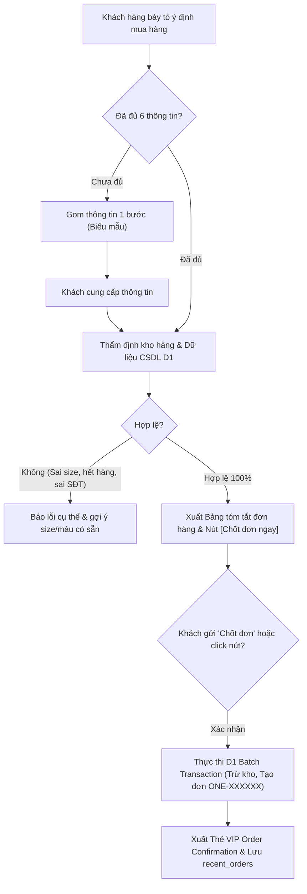

# QUY TRÌNH CHỐT ĐƠN TỰ ĐỘNG & NGHIỆP VỤ IN-CHAT ORDERING (ONE - STORE)

- **Mã định danh hệ thống:** `agentic-ordering`
- **Áp dụng cho:** Hệ thống Chatbot AI "Tư vấn One" và quy trình tạo đơn hàng tự động trực tiếp từ hội thoại.
- **Vai trò trong Chatbot:** Đặc tả logic nhận diện ý định đặt hàng, thẩm định kho dữ liệu thời gian thực trên CSDL Cloudflare D1, tính toán biểu phí, phát hành voucher và ghi nhận giao dịch thật.

---

## 1. NGUYÊN TẮC THIẾT KẾ: FRICTIONLESS & ZERO-HALLUCINATION

Hệ thống Agentic In-Chat Ordering của One - Store vận hành theo nguyên tắc:
1. **Không Ảo Giác Tồn Kho (Zero Hallucination):** Toàn bộ thông tin về giá, số lượng tồn kho (`stock`), kích cỡ (`sizes`) và màu sắc (`colors`) đều được thẩm định trực tiếp trên bảng `products` của CSDL Cloudflare D1 trước khi xác nhận.
2. **Giao Dịch Thật (Real D1 Transactions):** Khi chốt đơn, hệ thống ghi dữ liệu thật vào bảng `orders` và `order_items`, tự động trừ kho và tăng lượt dùng voucher `ONE10`. Khách hàng có thể tra cứu ngay trên trang `/orders`.
3. **Trải Nghiệm Gom Thông Tin 1 Bước (1-Step Information Gathering):** Không hỏi rải rác từng câu làm mất thời gian của khách; yêu cầu cung cấp toàn bộ thông tin còn thiếu trong một lần duy nhất.

---

## 2. QUY TRÌNH 4 BƯỚC CHỐT ĐƠN TỰ ĐỘNG

### Bước 1: Nhận Diện Ý Định & Gom Thông Tin 1 Bước
- Khi khách hàng nhắn các câu như: *"Tôi muốn mua đôi này"*, *"Đặt cho mình 1 đôi Novablast"*, *"Ship về cho mình"*, bot phân tích lịch sử trò chuyện để bóc tách các trường:
  - Tên sản phẩm (`productName`)
  - Cỡ giày (`size`)
  - Màu sắc (`color`)
  - Số lượng (`quantity`, mặc định là 1 đôi nếu không ghi rõ)
  - Họ và tên người nhận (`customerName`)
  - Số điện thoại (`phone`)
  - Địa chỉ nhận hàng (`address`)
- Nếu còn thiếu thông tin, bot gửi biểu mẫu gom thông tin ngắn gọn, tự động điền trước những gì đã chốt ở lượt trước (ví dụ: Size 39 - phù hợp chân 24cm đã tư vấn).

### Bước 2: Thẩm Định Kho Hàng & Dữ Liệu Thời Gian Thực (D1 Validation)
Backend đối soát trực tiếp với CSDL D1:
1. **Sản phẩm & Tồn kho:** Sản phẩm có tồn tại và `stock >= quantity` không.
2. **Kích cỡ (Size):** Cỡ giày khách chọn có nằm trong mảng `sizes` của sản phẩm không. Nếu không, từ chối và liệt kê các cỡ đang có sẵn.
3. **Màu sắc (Color):** Màu sắc có nằm trong mảng `colors` của sản phẩm không.
4. **Số điện thoại:** Phải đúng định dạng số di động Việt Nam (10 chữ số, bắt đầu bằng `03`, `05`, `07`, `08`, `09`).
5. **Địa chỉ nhận hàng:** Chi tiết tối thiểu 6 ký tự.

### Bước 3: Xuất Bảng Tóm Tắt & Nút Bấm Xác Nhận
Khi thông tin đã hợp lệ 100%, hệ thống tính toán tài chính:
- **Tạm tính:** `unit_price * quantity`.
- **Ưu đãi thành viên (Voucher ONE10):** Tự động áp dụng giảm 10% giá trị sản phẩm (`Math.floor(subtotal * 0.10)`).
- **Phí vận chuyển:**
  - `0 VND (Freeship toàn quốc)`: Nếu số lượng `>= 3 đôi` hoặc tạm tính `>= 5.000.000 VND`.
  - `30.000 VND`: Cho các đơn hàng thông thường.
- **Tổng thanh toán COD:** `subtotal - discount + shippingFee`.
- Hệ thống xuất Bảng tóm tắt đơn hàng rõ ràng và trả về cờ `readyToConfirm: true`.
- Giao diện người dùng lập tức hiển thị nút bấm nổi bật màu đỏ thể thao `[Chốt đơn ngay]`.

### Bước 4: Thực Thi Giao Dịch Thật Vào CSDL D1 (Atomic Batch)
Khi khách gửi tin nhắn `"Chốt đơn"` (hoặc click nút xác nhận):
1. Sinh mã đơn hàng chính thức: Tiền tố `'ONE-' + 8 ký tự hex ngẫu nhiên` (ví dụ: `ONE-3FB28928`).
2. Thực thi giao dịch nguyên tử `c.env.DB.batch(...)`:
   - Trừ tồn kho: `UPDATE products SET stock = stock - ? WHERE id = ? AND stock >= ?`.
   - Ghi đơn hàng: `INSERT INTO orders (code, customer_name, phone, address, note, total, voucher_code, discount, created_at)`.
   - Ghi chi tiết: `INSERT INTO order_items (order_id, product_id, product_name, size, color, quantity, unit_price)`.
   - Cập nhật voucher: `UPDATE vouchers SET used_count = used_count + 1 WHERE code = 'ONE10'`.
   - Xóa cache: `CACHE.delete('products:v1')`.
3. Trả về khối dữ liệu `createdOrder`.
4. Chatbot hiển thị **Thẻ xác nhận đơn hàng VIP** (màu xanh lá tươi, mã đơn có nút copy, nút bấm chuyển hướng trực tiếp tới `/orders?code=ONE-XXXXXX`), đồng thời tự động lưu mã đơn vào lịch sử thiết bị của khách hàng.

